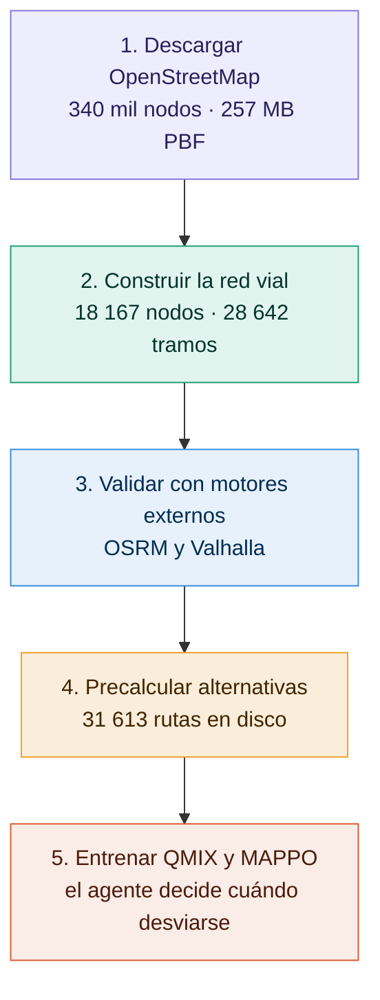
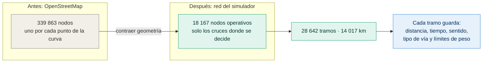
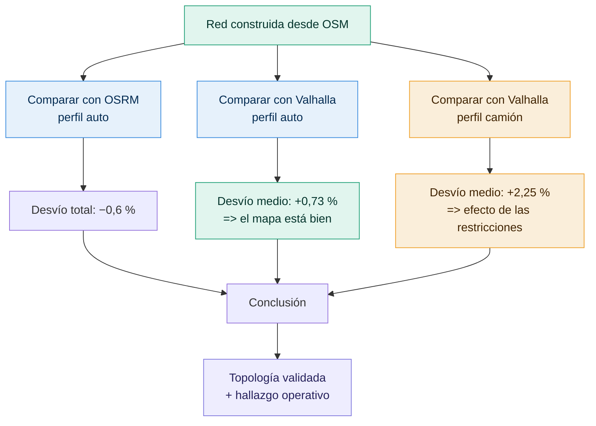
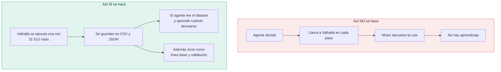
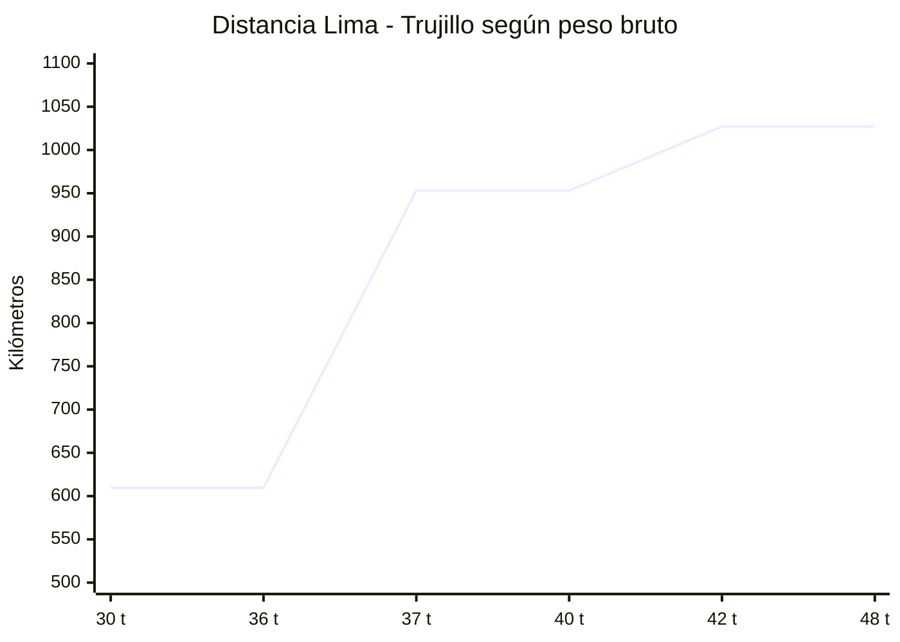
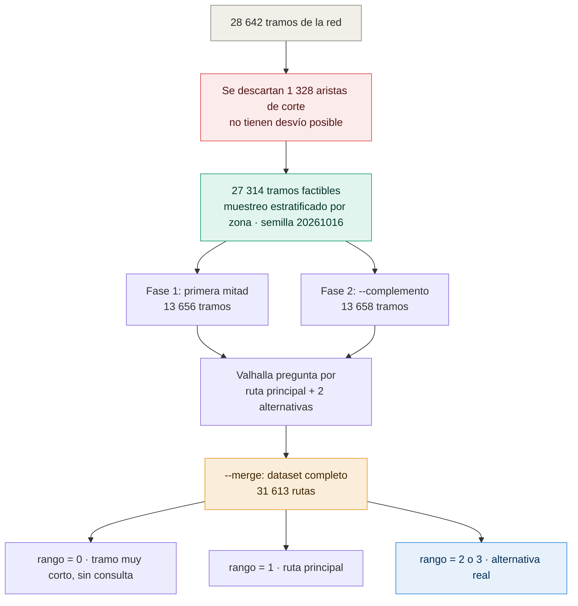
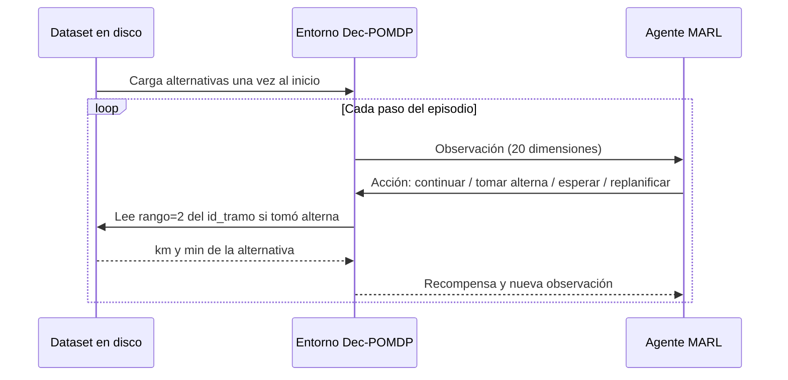

# Cómo se construyó el mapa y por qué se usa Valhalla

Explicación en lenguaje sencillo del trabajo realizado en el proyecto de tesis
**"Sistema multiagente basado en aprendizaje por refuerzo para la planificación
y monitoreo de rutas operativas en el transporte de carga"** (UNI – FIIS, Grupo 8).

Este documento no sustituye al [README](../README.md) ni a la documentación
técnica: es una **guía de lectura** para contar el trabajo de forma ordenada.
Cada sección tiene un diagrama que se puede mostrar directamente en la defensa.

---

## 1. Panorama general

El proyecto sigue cinco pasos. Los cuatro primeros preparan la información; el
quinto entrena al agente.



La idea importante: **Valhalla no aparece dentro del paso 5**. Aparece antes,
para preparar y comprobar. Más adelante se explica por qué.

---

## 2. Cómo se hizo el mapa

OpenStreetMap es un mapa muy detallado: guarda cada punto de una curva. Para un
camión eso es demasiado. Lo que se hizo fue **contraer la geometría**: reemplazar
los puntos intermedios de una calle por un solo **tramo**, conservando su
distancia y su tiempo de recorrido reales.



**Argumento para la tesis:** de 339 863 nodos originales se pasó a 18 167 nodos
operativos porque los puntos intermedios solo servían para dibujar la curva; no
eran decisiones de ruta. Ningún kilómetro se perdió: la distancia real quedó
guardada dentro de cada tramo.

### Cobertura

Al principio la red cubría solo el corredor norte y dejaba fuera 4 de los 25
puntos de entrega de la empresa: **187 viajes (37,4 %) no se podían reconstruir**.
Se amplió con la Carretera Central a Huancayo, el ramal a Paita y el acceso al
CEDI de Lima. Resultado: **500 de 500 viajes reconstruidos (100 %)**.

| Indicador | Antes | Después |
|---|---:|---:|
| Nodos operativos | 13 918 | **18 167** |
| Tramos | 21 918 | **28 642** |
| Longitud | 10 547,9 km | **14 017,1 km** |
| Ciudades | 6 | **8** |
| Viajes reconstruidos | 313 / 500 | **500 / 500** |

---

## 3. Cómo supimos que el mapa estaba bien

La clave metodológica es que **no nos creímos nuestro propio mapa**. Si uno mide
su error con el mismo mapa que construyó, la prueba no sirve. Se usaron motores
**ajenos** a la construcción:



**Por qué se compara primero en modo auto:** para separar dos efectos que se
pueden confundir. En modo auto no hay restricciones de pesados, así que cualquier
diferencia sería error del mapa. Como el error es menor al 1 %, la topología queda
validada. El desvío mayor en modo camión no es error: es la prohibición de
tránsito pesado en la salida de Lima (`hgv=no` en la Vía Expresa y Javier Prado),
que obliga a rodear y cuesta **49,5 km extra** en Lima–Trujillo.

---

## 4. Para qué sirve Valhalla (y por qué no está en el entrenamiento)

Si Valhalla eligiera la ruta en cada paso, el problema se volvería trivial:
bastaría con llamar al motor. El agente no tendría nada que aprender. Por eso se
usa **fuera** del bucle de aprendizaje.



Valhalla cumple tres papeles, todos **antes** del entrenamiento:

| Papel | Qué produce |
|---|---|
| Referencia externa | La ruta de un motor ajeno, contra la que se compara la política aprendida |
| Generación de candidatas | Alternativas reales sobre las que el agente puede decidir |
| Validación independiente | Prueba de que la red derivada de OSM es razonable |

Se eligió Valhalla sobre OSRM y GraphHopper porque incluye **perfil de camión
nativo** (peso, alto, ancho, largo, carga por eje) y control de solapamiento en
sus alternativas, en una sola llamada.

---

## 5. El hallazgo de las 37 toneladas

Al barrer el peso del camión, la ruta Lima–Trujillo se mantiene estable hasta
36 t y luego salta. Es el resultado operativo más citables de la parte de mapas.



| Peso | LIM–TRU | Cambio |
|---:|---:|---|
| 30–36 t | 609,6 km | ruta directa |
| 37–40 t | 953,1 km | **+343 km** |
| 42–48 t | 1 027,2 km | +418 km |

La causa está en la red, no en el motor: cinco tramos de la Panamericana Norte
tienen `peso_max_t = 36`. Ningún otro par del corredor es sensible al peso.

**Consecuencia para el escenario:** el camión de referencia se fija en **36 t**.
Si se subiera a 42 t, el corredor Lima–Trujillo dejaría de existir como tal y el
problema de ruteo cambiaría de naturaleza.

---

## 6. El dataset de entrenamiento

Consultar Valhalla en tiempo real durante el entrenamiento sería inviable:
2 000 episodios × 591 tramos por ruta × 3 agentes implica millones de llamadas.
Por eso se precalcula todo una sola vez.



De los 27 314 tramos factibles, Valhalla respondió en **15 741**; el resto son
tramos de menos de 50 m donde origen y destino casi coinciden. Solo **2 993**
tienen una alternativa real. Que sean pocos no es un fallo: confirma que, para un
camión pesado, el corredor es casi un eje único. Eso es justamente lo que hace
interesante la decisión del agente: desviarse es costoso y no siempre posible.

### Cómo se usa en el entrenamiento



El estado global (58 dimensiones) solo existe en modo CTDE: se usa para
entrenar al crítico, no lo ve cada agente durante la ejecución.

---

## 7. Guion para la defensa

> **¿Cómo llegaron a los mapas?**
> Descargamos OpenStreetMap, contraímos su geometría hasta dejar solo los cruces
> donde un camión puede decidir, y validamos el resultado contra dos motores
> externos que no intervinieron en la construcción. El error es menor al 1 % en
> modo auto y el mapa cubre el 100 % de los viajes registrados.

> **¿Para qué sirve Valhalla?**
> No está dentro del entrenamiento, porque entonces el agente no aprendería
> nada. Se usa antes, una sola vez, para tener una ruta de referencia, generar
> alternativas reales y comprobar que el mapa está bien.

> **¿Qué descubrieron?**
> Que la operación real está limitada por pesos: a 37 toneladas la ruta
> Lima–Trujillo se alarga 343 km. Por eso el camión de referencia se fija en
> 36 toneladas.

### Números que conviene tener a mano

| Concepto | Cifra |
|---|---:|
| Nodos OSM → nodos operativos | 339 863 → 18 167 |
| Tramos / longitud de la red | 28 642 / 14 017,1 km |
| Error del mapa vs Valhalla (auto) | +0,73 % |
| Desvío en camión (salida de Lima) | +2,25 % (49,5 km extra) |
| Umbral que rompe el corredor | 36 t → a 37 t, 609,6 → 953,1 km |
| Tramos con desvío posible | 27 314 (95,4 %) |
| Rutas precalculadas para entrenar | 31 613 |

### Limitaciones que es mejor admitir

1. Solo el 11 % de los tramos tiene alternativa real. Es una limitación del
   territorio, no del método, y refuerza la premisa del problema.
2. Hay 33 tramos sin respuesta de Valhalla (0,12 %) y 39 paradas con coordenada
   colapsada en el dato original de la empresa.
3. El simulador aún no consume el dataset automáticamente: el uso del campo
   `rango` está documentado, pero falta cablearlo en `scripts/03_entrenar.py`.

---

## 8. Cómo reproducirlo

```bash
cd infra/valhalla && docker compose up -d

python scripts/01_red_vial.py                    # construye la red
python scripts/05_diagnostico_movimiento.py      # verifica que se recorre
python scripts/08_rutas_valhalla.py              # validación y referencia
python scripts/08_rutas_valhalla.py --sensibilidad-peso

python scripts/10_dataset_entrenamiento.py       # primera mitad
python scripts/10_dataset_entrenamiento.py --complemento
python scripts/10_dataset_entrenamiento.py --merge
```

Todo deriva de la semilla `20261016`, así que los resultados son reproducibles.
